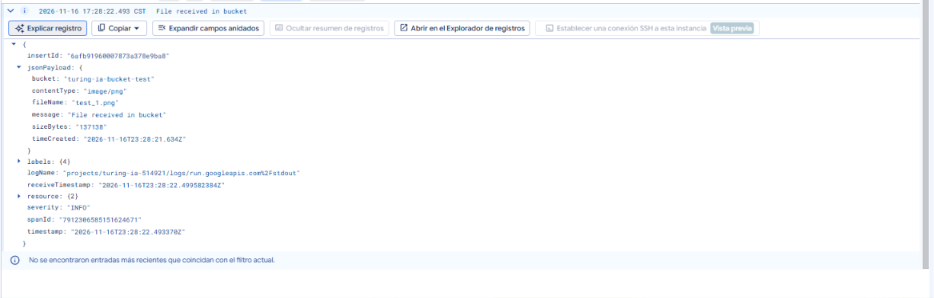

# Turing-IA - GCP & Workspace Trial Period

Repository for the technical challenges of the GCP | Workspace trial period at Turing Inteligencia Artificial.

## Day 1 - GCP Infrastructure Setup

### Prerequisites

- A Google Cloud account with billing enabled
- `gcloud` CLI (or just the Cloud Console, which is what this project used)
- Node.js 22+ and npm
- A GitHub account

### Setup steps (reproducible walkthrough)

1. Create a new GCP project (`turing-ia-514921`).
2. Enable the required APIs: Cloud Storage, Cloud Functions, Cloud Pub/Sub, Cloud Logging, Cloud Resource Manager, Eventarc.
3. In IAM, grant a test principal the **Viewer** role (project-level) to simulate least-privilege access.
4. Create the Cloud Storage bucket (`turing-ia-bucket-test`) with:
   - Region: `us-central1`, Standard storage class
   - Uniform bucket-level access + public access prevention
   - A lifecycle rule: delete objects older than 30 days
   - Grant the same test principal **Storage Object Viewer** at the bucket level
5. Write the Cloud Function (`index.js` + `package.json`) and push it to this repository.
6. Connect this repository to Cloud Build (Triggers → Connect Repository → GitHub App).
7. Create a Cloud Build trigger on push to `main`, pointing to `cloudbuild.yaml`.
8. Grant `roles/pubsub.publisher` to the Cloud Storage service agent — required once per project for Storage-triggered Eventarc triggers.
9. Push to `main` → Cloud Build deploys the function automatically.
10. Validate end-to-end by uploading a file to the bucket and checking the function's logs.

### Screenshots

Cloud Function log after uploading a file 

### Architecture

```
Cloud Storage bucket (turing-ia-bucket-test)
        │  object finalized event
        ▼
Eventarc trigger
        │
        ▼
Cloud Function (process-bucket-upload, Node.js 22, 2nd gen)
        │  extracts metadata (name, size, type, timestamp)
        ▼
Cloud Logging (structured JSON logs)
```

### Resources created

- **GCP Project:** `turing-ia-514921`
- **Bucket:** `turing-ia-bucket-test` (us-central1, Standard class, uniform access, public access prevention enabled)
  - Lifecycle rule: delete objects older than 30 days
  - Fine-grained access: a test principal holds project-level `Viewer` plus bucket-level `Storage Object Viewer`
- **Cloud Function:** `process-bucket-upload` — triggered by `google.cloud.storage.object.v1.finalized` on the bucket above

### CI/CD

Deployment is automated with a **Cloud Build trigger** connected to this GitHub repository: every push to `main` runs `cloudbuild.yaml`, which deploys the function via `gcloud functions deploy`.

### Local development

```bash
npm install
npm test        # runs unit tests (Node's built-in test runner)
```

### Manual end-to-end test

1. Upload any file to the `turing-ia-bucket-test` bucket.
2. Check **Cloud Functions → process-bucket-upload → Logs** — a structured log entry should appear with the file's metadata within a few seconds.

### Design decisions

- **`console.log` / `console.error` instead of a logging client library:** Cloud Functions/Cloud Run automatically capture stdout/stderr into Cloud Logging. Writing structured JSON with a `severity` field lets Cloud Logging parse and filter logs correctly without adding an extra dependency.
- **Least privilege:** the test IAM principal only has `Viewer` (project) and `Storage Object Viewer` (bucket) — read-only, following the principle of least privilege instead of granting Editor/Owner.
- **Node.js 22 runtime:** Node 18 and 20 are no longer supported for Cloud Functions 2nd gen at the time of this challenge; 22 is the current minimum available.

### Issues found and resolved

| Problem | Cause | Fix |
| --- | --- | --- |
| Build failed on `logs_bucket` config | Custom service account selected without a logging destination | Added `options: logging: CLOUD_LOGGING_ONLY` to `cloudbuild.yaml` |
| `nodejs18` / `nodejs20` rejected as runtime | Deprecated for Cloud Functions 2nd gen | Switched to `nodejs22` |
| Cloud Resource Manager API disabled | Not enabled by default on a new project | Enabled via Console |
| Eventarc API disabled | Not enabled by default on a new project | Enabled via Console |
| `storage.buckets.get` denied when creating the trigger | Cloud Storage's service agent lacked permission to publish events to Pub/Sub | Granted `roles/pubsub.publisher` to `service-<PROJECT_NUMBER>@gs-project-accounts.iam.gserviceaccount.com` |

## Day 2 - Google Workspace Automation

Simulated a Workspace environment using Google Groups (no domain or paid trial required — the challenge explicitly allows "a test environment or demo accounts"), and built an automation script in Google Apps Script bound to a Google Sheet (`Turing IA - Automation Tracker`).

### What was built

- **Google Group** (`turing-ia-gcp-workspace-team@googlegroups.com`) with restricted-access policies and a two-level role hierarchy (Owner / Manager).
- **Apps Script project** (`turing-ia-automation-tracker`) with three functions:
  - `processSheetData()` — reads rows, classifies each as `HIGH PRIORITY` / `NORMAL` based on amount.
  - `sendNotifications()` — emails the owner for each unnotified high-priority row.
  - `createFollowUpEvents()` — schedules a Google Calendar follow-up for each notified row.
- **Triggers**: `onEdit` (immediate) for `processSheetData`, hourly time-driven triggers for the other two.

### Issues found and resolved

| Problem | Cause | Fix |
| --- | --- | --- |
| Duplicate Calendar events on repeated runs | `createFollowUpEvents` had no way to know a row was already scheduled | Added a `Scheduled` boolean column, checked before creating an event |

Full write-up, screenshots and code comments: see `apps-script/Code.gs` and the Day 2 technical report (delivered separately as a PDF/Word document).

## Day 3 - Full Integration, Security & Deployment

Connected the Day 1 Cloud Function to the Day 2 Apps Script project through a signed webhook, so uploading a file to the bucket automatically logs it in a Sheet and sends a notification — with authentication and data validation at every step.

### Architecture

```
Cloud Storage bucket (turing-ia-bucket-test)
        │  object finalized event
        ▼
Eventarc trigger
        │
        ▼
Cloud Function (process-bucket-upload)
        │  1. validates metadata
        │  2. signs payload (HMAC-SHA256)
        ▼
HTTPS POST  ──────────────────────────────►  Apps Script Web App (doPost)
                                                   │  1. validates signature
                                                   │  2. appends row to "GCS File Events" sheet
                                                   │  3. sends Gmail notification
                                                   ▼
                                     Google Sheet + Gmail inbox
```

### Security measures

- **Webhook authentication**: HMAC-SHA256 signature over the payload, computed with a shared secret. Chosen over OAuth/ID tokens because Apps Script has no native way to validate Google-signed JWTs, while both sides already have simple HMAC primitives (`crypto` in Node, `Utilities.computeHmacSha256Signature` in Apps Script). See the Day 3 report for the full comparison against OAuth, API keys and mTLS.
- **Secret management**: both the HMAC secret and the webhook URL are stored in **Secret Manager**, injected into the Cloud Function at deploy time via `--set-secrets` (never committed to the repository or visible in Cloud Build logs).
- **Least privilege**: the function's runtime service account was granted `Secret Manager Secret Accessor` only on the two specific secrets it needs — not at the project level.
- **Data validation at every stage**: the Cloud Function validates file metadata before sending anything (`src/validation.js`); the webhook independently validates required fields and the signature before writing to the Sheet.

### Issues found and resolved

| Problem | Cause | Fix |
| --- | --- | --- |
| Deploy failed: "Permission denied on secret" | The function's actual runtime service account (Compute Engine default) differed from the one shown in the Cloud Run console (App Engine default) | Granted `Secret Manager Secret Accessor` to the correct service account, identified from the deploy error message |
| Webhook returned `"Failed to send email: no recipient"` | `Session.getActiveUser().getEmail()` returns empty when the Web App is invoked by an anonymous external caller (even though it runs with the owner's authority) | Stored the recipient as a fixed Script Property (`NOTIFICATION_EMAIL`) instead |
| One notification out of a batch wasn't marked `Notified = true`, despite the email being sent | Race condition: concurrent `doPost` executions (triggered by near-simultaneous file uploads) interleaved `appendRow()` + `getLastRow()`, so one execution read another's row index | Wrapped the critical section in `LockService.getScriptLock()`, serializing concurrent executions |

### Manual end-to-end test (multi-file)

1. Upload 2-3 files to `turing-ia-bucket-test` at the same time.
2. Check **Cloud Functions → process-bucket-upload → Logs** — one `"File received in bucket"` and one `"Webhook call finished"` (HTTP 200) per file.
3. Check the `GCS File Events` sheet tab — one new row per file, all with `Notified = TRUE`.
4. Check Gmail — one notification email per file.

Full write-up, screenshots, response-time data and lessons learned: see the Day 3 technical report (delivered separately as a PDF/Word document).

## Repository structure

```
.
├── apps-script/
│   ├── Code.gs           # Day 2: Workspace automation logic (reference copy)
│   └── Webhook.gs        # Day 3: webhook receiver (reference copy)
├── screenshots/
├── src/
│   ├── validation.js    # Metadata validation
│   └── webhook.js       # HMAC signing + webhook call
├── test/
│   └── index.test.js     # Unit tests
├── cloudbuild.yaml       # CI/CD pipeline (Cloud Build)
├── index.js             # Cloud Function entry point (orchestration only)
├── package.json
└── README.md
```